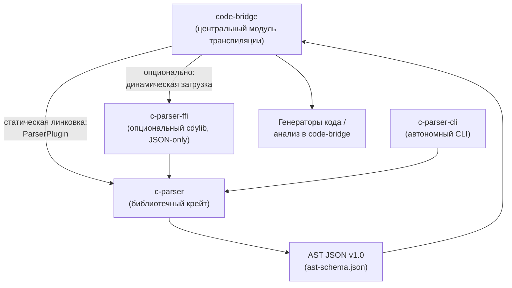
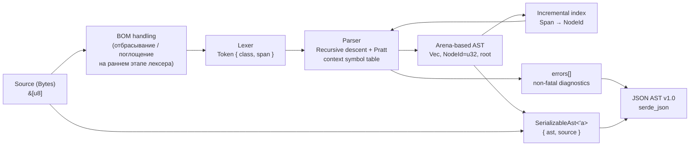

# Документ архитектуры модуля `c-parser`

**Версия документа:** 1.1  
**Статус:** Архитектурное описание для реализации  
**Связанные документы:** ТЗ на `c-parser` v2.2, `docs/ast-schema.json` v1.0

---

## 1. Назначение и место `c-parser` в экосистеме `code-bridge`

`c-parser` — самостоятельный Cargo-workspace и библиотечный крейт для синтаксического анализа исходного кода на языке C с построением AST в arena-based представлении и последующей JSON-сериализацией по фиксированной схеме `ast-schema.json` v1.0.

Модуль является первым представителем семейства парсеров для `code-bridge` — центрального связующего модуля системы транспиляции. В перспективе аналогично должны быть устроены `cpp-parser`, `rust-parser`, `python-parser` и др., поэтому архитектура `c-parser` должна допускать тиражирование без пересмотра ключевых решений: единый контракт `ParserPlugin`, единый JSON-формат с полем `language`, единая схема версионирования AST.

`code-bridge` не должен зависеть от внутренних типов `c-parser` — `Ast`, `Node`, `NodeId`, `Span`, арены. Контракт интеграции ограничен:

1. публичным трейтом `ParserPlugin` при статической линковке;
2. JSON-схемой AST v1.0 при обмене через JSON;
3. опциональным FFI-слоем `c-parser-ffi`, где граница обмена — исключительно JSON-строки.

### 1.1. Контекстная диаграмма



### 1.2. Границы ответственности

Модуль выполняет только лексический и синтаксический анализ. В зону ответственности не входят:

- полноценный препроцессор C;
- семантический анализ, кроме минимального разрешения `typedef-name` vs `identifier`;
- межфайловый анализ;
- генерация кода;
- промышленный error recovery уровня `clang`/`rustc`;
- постоянная сериализация AST после каждого инкрементального обновления.

Поддерживаются два режима препроцессинга:

- `Preprocessed` — по умолчанию и рекомендуется: вход уже обработан, например, `gcc -E`; `typedef` разрешаются корректно.
- `SingleTu` — одна единица трансляции как есть; директивы `#include`, `#define` и др. фиксируются как узлы AST без раскрытия; `typedef` разрешаются только при наличии объявлений в анализируемом фрагменте.

---

## 2. Ключевые архитектурные принципы

1. **Arena-based AST.** Все узлы размещаются в плоском массиве `Vec<Node>`, связи — через 32-битные `NodeId`. Это обеспечивает O(1) добавление узла, пространственную локальность, простой обход и предсказуемую сериализацию.
2. **Zero-copy на этапе анализа.** Исходный код хранится как неизменяемый `&[u8]`. Токены и узлы не копируют строки: идентификаторы и литералы представлены только `Span`. Строковые значения материализуются позже.
3. **Lazy materialization при сериализации.** JSON должен быть самодостаточным, поэтому `ast_to_json(ast, source)` извлекает подстроки по `Span` только в момент сериализации. Для невалидного UTF-8 используется `String::from_utf8_lossy`, паника исключена.
4. **Двухфазный парсинг.** Фаза A — рекурсивный спуск с контекстной таблицей символов для объявлений и инструкций. Фаза B — Pratt parsing для выражений с приоритетами и ассоциативностью.
5. **Инкрементальность in-memory.** Инкрементальное обновление работает в памяти и не сериализует JSON автоматически. Для O(log N) поиска узла-контейнера используется отдельный отсортированный индекс `Span → NodeId`, а не «сырой» бинарный поиск по арене.
6. **Статическая линковка как основной способ интеграции.** Динамическая загрузка опциональна и допускается только через JSON-only FFI.
7. **Безопасность памяти и потокобезопасность.** Парсер должен быть `Send + Sync`; независимые экземпляры могут работать параллельно.
8. **Схема AST фиксирована и версионируется.** JSON соответствует `docs/ast-schema.json` v1.0; несовпадение мажорной версии — ошибка интеграции.

---

## 3. Диаграмма потоков данных



Поток данных устроен следующим образом:

1. **Source (Bytes).** Входной буфер `&[u8]` неизменяем и живёт на протяжении анализа и сериализации.
2. **BOM handling.** UTF-8 BOM в начале файла отбрасывается или корректно поглощается на самом раннем этапе лексера (см. п. 5.2), чтобы не сдвигать `span.start` первого токена и не ломать контракт `span.start = 0` для файлов без BOM.
3. **Lexer.** Выдаёт токены `{ class, span }` без копирования строк. Комментарии либо пропускаются, либо сохраняются по флагу `include_comments`.
4. **Parser.** Выполняет рекурсивный спуск и Pratt parsing, ведёт контекстную таблицу символов для `typedef`, диалект C, режим препроцессинга. При ошибках добавляет `ErrorNode` и записи в `errors[]`.
5. **Arena-based AST.** Узлы добавляются в плоский массив; `root` и `children[]` — индексы `NodeId`. Арена не содержит указателей и не требует сложного управления временем жизни.
6. **Incremental index.** Для инкрементального режима поддерживается отсортированный индекс `Span → NodeId` или интервальное дерево; он позволяет найти минимальный узел-контейнер за O(log N).
7. **SerializableAst.** Обёртка `{ ast, source }`, реализующая `Serialize` вручную: при обходе узлов строковые поля материализуются из `source` по `Span`.
8. **JSON AST v1.0.** Итоговый JSON самодостаточен: потребителю не нужен исходный буфер. `errors[]` содержит нефатальные диагностики; фатальные ошибки возвращаются через API/CLI как `Err`.

---

## 4. Роли модулей `crates/c-parser/src/`

| Модуль | Роль | Ключевые решения |
|---|---|---|
| `lib.rs` | Публичное API крейта | `ParseInput`, `ParserConfig`, `ParseResult`, `Ast`, `Node`, `ParserPlugin`, `create_parser`, `parse`, `ast_to_json`, `ast_from_json`; реэкспорт ключевых типов. |
| `arena.rs` | Arena-based AST | Плоское хранилище `Vec<Node>`, выдача `NodeId = u32`, O(1) добавление в конец, стабильные индексы, отсутствие указателей. Выделен в отдельный документированный модуль как ключевая инженерная и научная инновация проекта. |
| `ast/` | Модель AST | `Span` — полуинтервал `[start, end)` в байтах; `NodeKind`; `NodeData` как tagged union с `#[serde(tag = "type")]`; `Ast { root, nodes, source_length }`; инварианты `span.start <= span.end <= source_length`, валидность `root`/`children`/`error_index`. |
| `lexer/` | Zero-copy лексический анализ | Токен хранит только класс и `Span`; идентификаторы и литералы не копируются. Отбрасывание/поглощение UTF-8 BOM на самом раннем этапе, чтобы первый токен имел корректный `span.start` (см. п. 5.2). Поддержка ключевых слов, операторов, разделителей, литералов, комментариев по флагу. В `SingleTu` директивы препроцессора фиксируются как узлы. |
| `parser/` | Синтаксический анализ | Фаза A: рекурсивный спуск + контекстная таблица символов для `typedef`. Фаза B: Pratt parsing выражений за линейное время. Диалекты C89/C99/C11/C17. Упрощённый error recovery: синхронизация на `;`, `{`, `}`, добавление `ErrorNode`. |
| `incremental/` | Инкрементальное обновление in-memory | По изменённому `Span` находит минимальный узел-контейнер через `index/`, инвалидирует дочерние индексы, перестраивает только повреждённое поддерево, добавляет новые узлы в арену. Сложность O(log N + K). JSON автоматически не сериализуется. |
| `index/` | Индекс `Span → NodeId` | Отсортированный `Vec<(Span, NodeId)>` или интервальное дерево. Обеспечивает честный O(log N) поиск узла-контейнера; обновляется при мутациях арены. Для MVP рекомендуется отсортированный вектор. |
| `serialize/` | JSON-сериализация и lazy materialization | `SerializableAst<'a> { ast, source }`; ручная реализация `Serialize` с `serialize_map`, подстановкой строк по `Span` и `String::from_utf8_lossy`. `ast_from_json` читает строки из JSON и не требует исходного буфера. |
| `error.rs` | Ошибки | `ParseError`, стабильные коды, сообщение, `Span`, серьёзность; разделение нефатальных диагностик (`errors[]`) и фатальных `Err`. |

Дополнительно:

- `crates/c-parser-cli` — CLI-обёртка `parse` и `parse-incremental`, вывод JSON, диалект, режим препроцессинга, `--pretty`, `--include-comments`, конфигурация TOML.
- `crates/c-parser-ffi` — опциональный `cdylib`; граница только JSON-строки через указатель + длина; освобождение через `CString::into_raw` / `CString::from_raw`.

---

## 5. Модель AST и сериализация

### 5.1. Представление узла

Публичная модель соответствует ТЗ и схеме:

```rust
pub struct Ast {
    pub root: NodeId,
    pub nodes: Vec<Node>,
    pub source_length: usize,
}

pub struct Node {
    pub kind: NodeKind,
    pub span: Span,
    pub children: Vec<NodeId>,
    pub data: NodeData,
}
```

Внутри арены узлы не хранят строковых значений. Поля `name`, `value`, `op`, `storage_class` и т.п. материализуются при сериализации из исходного буфера по `Span`. Это относится и к `Identifier`, и к литералам, и к именам функций/переменных.

`NodeData` — tagged union с дискриминатором `"type"`. Схема допускает сокращённые дискриминаторы: `FunctionDefinition` → `FunctionDef`, `VariableDeclaration` → `VariableDecl`, `ParameterDeclaration` → `ParameterDecl`, `TypedefDeclaration` → `TypedefDecl`, `StructDeclaration` → `StructDef`, `UnionDeclaration` → `UnionDef`, `EnumDeclaration` → `EnumDef`. Структурные узлы без атрибутов обязаны иметь `"data": null`; это проверяется per-kind `oneOf` в JSON Schema и кастомным валидатором.

### 5.2. Lazy materialization и обработка BOM

`ast_to_json` принимает AST и исходный буфер:

```rust
pub fn ast_to_json(ast: &Ast, source: &[u8]) -> Result<String, serde_json::Error> {
    serde_json::to_string(&SerializableAst { ast, source })
}
```

`SerializableAst` реализует `Serialize` вручную, потому что `serde::Serialize` не принимает внешний контекст. При обходе `self.ast.nodes` для каждого строкового поля выполняется извлечение подстроки:

```rust
String::from_utf8_lossy(&source[span.start..span.end]).into_owned()
```

Некорректные байты заменяются на ``; парсер не падает на невалидном UTF-8. JSON получается самодостаточным: `code-bridge` и генераторы не нуждаются в исходном файле.

**Обработка BOM.** Если файл начинается с UTF-8 BOM (`EF BB BF`), лексер обязан отбросить его либо корректно поглотить на самом раннем этапе — до выдачи первого токена и до формирования каких-либо `Span`. Это гарантирует, что:

- для файлов без BOM первый токен имеет `span.start = 0`, как и ожидается по контракту схемы;
- для файлов с BOM `span`-ы не сдвигаются на три байта, и `source_length` остаётся согласованным с реальным содержимым, которое видит потребитель;
- материализация строк по `Span` в `SerializableAst` не захватывает BOM-байты в значения полей `name`/`value` первого токена.

Соответственно, `source_length` в итоговом AST должен отражать длину буфера после такой нормализации, чтобы инвариант `span.end <= source_length` оставался корректным и проверяемым кастомным валидатором. Решение об отбрасывании/поглощении BOM фиксируется в `docs/api.md` и покрывается тестом на файле с BOM.

### 5.3. Инварианты и валидация

Помимо JSON Schema, валидатор и парсер обеспечивают:

- `span.start <= span.end` и `span.end <= source_length`;
- `root` и все `children[]` ссылаются на существующие индексы `nodes[]`;
- `ErrorNode.data.error_index` ссылается на существующую запись `errors[]`;
- для `Preprocessor*` поле `data.directive` соответствует суффиксу `kind`;
- структурные `kind` имеют `data: null`;
- `DataPreprocessorDirective.argument` — всегда строка, для директив без аргументов `""`, не `null`;
- опциональные поля `suffix`, `encoding`, `is_macro` могут отсутствовать; потребитель обязан применять документированные значения по умолчанию.

---

## 6. Инкрементальный режим

Инкрементальный режим доступен через библиотечное API `parse_incremental(input, change)`. Алгоритм:

1. По изменённому диапазону `M = [start, end)` выполняется поиск в `index/` — отсортированном индексе `Span → NodeId` или интервальном дереве.
2. Находится минимальный узел-контейнер, чей `Span` полностью покрывает `M`, например тело функции или блочный оператор.
3. Инвалидируются дочерние индексы найденного узла.
4. Лексический и синтаксический анализ перезапускаются локально — только для текста в границах повреждённого узла.
5. Новые поддеревья добавляются в арену, индексы обновляются.

Временная сложность — O(log N + K), где `N` — число узлов, `K` — размер модифицированного блока. Это соответствует требованию ТЗ и научной статьи для интеграции в LSP-серверы и среды разработки.

Важно: после инкрементального обновления JSON не сериализуется автоматически. Иначе выгода O(log N + K) нивелируется O(N)-сериализацией. JSON генерируется по явному запросу — при сохранении файла, запросе на транспиляцию или по команде CLI `parse-incremental`, которая для автономного использования возвращает полный JSON по завершении обновления.

---

## 7. Обоснование архитектурных решений

### 7.1. Почему Rust

Выбор Rust обусловлен требованиями ТЗ и научной статьи:

- **Безопасность памяти без GC.** Ownership и borrowing позволяют исключить утечки, use-after-free и гонки данных, что критично для инструмента, встраиваемого в `code-bridge`, LSP-серверы и статические анализаторы.
- **Предсказуемая производительность.** Нет пауз сборщика мусора; память освобождается детерминированно.
- **`Send + Sync`.** Независимые экземпляры парсера могут работать параллельно.
- **Удобная статическая интеграция.** Cargo-крейты и общий трейт `ParserPlugin` — основной способ интеграции; FFI остаётся опциональным и ограничен JSON-строками.
- **Безопасная граница FFI.** Сложные типы не пересекают границу динамической библиотеки; память выделяется и освобождается аллокатором Rust через `CString::into_raw` / `CString::from_raw`.

В научной статье Rust выбран именно как язык, позволяющий оптимизировать потребление памяти за счёт механизмов владения и заимствования и минимизировать число операций копирования.

### 7.2. Почему Arena-based AST

Традиционные AST с указателями в куче создают накладные расходы на управление памятью, фрагментацию и время жизни узлов. В Rust это особенно заметно при попытке построить граф с перекрёстными ссылками.

Arena-based подход даёт:

- **O(1) добавление узла** — добавление в конец `Vec<Node>`;
- **пространственную локальность** — смежные узлы лежат рядом, что уменьшает cache misses при обходе;
- **простую сериализацию** — плоский массив индексов естественно отображается в JSON `nodes[]` с `root` и `children[]`;
- **отсутствие указателей и сложных lifetime-связей** — `NodeId = u32` вместо `Box`/`Rc`/`Arc`;
- **удобство инкрементальных мутаций** — индексы стабильны, арена расширяется линейно.

Формально дерево представляется как `T = <A, R>`, где `A` — одномерный массив узлов, `R` — индекс корня. Это соответствует описанию алгоритма в научной статье. Модуль `arena.rs` вынесен отдельно, поскольку арена — ключевая инженерная и научная инновация проекта; её изоляция упрощает сопровождение и описание в статье.

**Ограничение `NodeId = u32`.** Использование 32-битных индексов ограничивает максимальное количество узлов в дереве примерно 4.29 млрд (`2^32 - 1`), что с огромным запасом покрывает любые разумные размеры входных файлов: даже файл в 100 МБ на C создаст меньше 10–20 млн узлов, то есть на два порядка меньше предела. При приближении к пределу арена возвращает фатальную ошибку (`Err`) до переполнения индекса, а не зацикливается и не паникует. Это осознанный компромисс: 32 бита вдвое сокращают размер узла по сравнению с 64-битными индексами и улучшают пространственную локальность, а запас по ёмкости для реальных кодовых баз остаётся практически неисчерпаемым.

### 7.3. Почему Zero-copy + Lazy materialization

Zero-copy на этапе лексического и синтаксического анализа означает, что исходный код не копируется в строки. Токен описывается как `t_i = <K, S, E>`, где `K` — класс, `S` и `E` — границы в исходном буфере. Это снижает потребление памяти и время анализа, особенно на больших legacy-кодовых базах.

При этом JSON должен быть самодостаточным для `code-bridge` и генераторов. Поэтому строки материализуются только при сериализации:

- на этапе анализа — никаких аллокаций строк для идентификаторов и литералов;
- при `ast_to_json` — извлечение подстрок по `Span` и `String::from_utf8_lossy`;
- при `ast_from_json` — строки читаются из JSON, исходный буфер не нужен.

Такая схема сохраняет преимущества zero-copy и одновременно удовлетворяет требованию самодостаточности JSON. Ручная реализация `Serialize` для `SerializableAst` — осознанная цена: `serde` не передаёт контекст вглубь рекурсии, поэтому обход `nodes` и подстановка строк по `Span` выполняются явно через `serialize_map`. Код многословнее, но предсказуем и документирован в `docs/api.md`.

Отдельно отметим обработку BOM (см. п. 5.2): она выполняется на уровне лексера до формирования `Span` и до любой материализации строк, поэтому не нарушает ни zero-copy-контракт, ни инварианты схемы.

### 7.4. Почему гибридный парсер: рекурсивный спуск + Pratt

Грамматика C содержит контекстно-зависимую неоднозначность `typedef-name` vs `identifier` и богатую иерархию приоритетов операторов. Поэтому:

- объявления и инструкции разбираются рекурсивным спуском с контекстной таблицей символов;
- выражения разбираются алгоритмом Пратта, который обрабатывает приоритеты и ассоциативность за линейное время O(n) с плоским циклом и таблицей binding power, избегая глубокого стека вызовов.

Это соответствует гибридному алгоритму, описанному в научной статье, и требованиям ТЗ.

### 7.5. Почему отдельный индекс `Span → NodeId`

Узлы добавляются в арену в порядке обхода и не гарантированно отсортированы по `span.start`. Поэтому «сырой» бинарный поиск по `Vec<Node>` некорректен. Для честного O(log N) вводится отдельный отсортированный индекс `Vec<(Span, NodeId)>` или интервальное дерево. Для MVP рекомендуется отсортированный вектор: он проще, достаточен для заявленной сложности и легко обновляется при мутациях.

---

## 8. Интеграция с `code-bridge`

### 8.1. Статическая линковка — основной способ

`code-bridge` добавляет зависимость на `c-parser`, регистрирует парсер в реестре плагинов и вызывает `parse`/`parse_incremental`. Оболочка получает `ParseResult`, при необходимости сериализует AST через `ast_to_json(&ast, input.source)` и передаёт JSON генератору. `code-bridge` не зависит от внутренних типов парсера.

### 8.2. Динамическая загрузка — опционально

`c-parser-ffi` собирается как `cdylib` и предоставляет `c_parser_parse` и `c_parser_free_string`. Граница обмена — только JSON-строки через указатель + длина. Сложные типы не пересекают границу. Освобождение памяти выполняет аллокатор Rust.

### 8.3. Контракт совместимости

- Версия JSON-схемы AST — `1.0`; при несовпадении мажорной версии `code-bridge` фиксирует ошибку интеграции.
- Поле `language` обязательно и равно `"c"`; оно введено для мультиязычного семейства парсеров.
- Внутренние типы `c-parser` не являются частью контракта.
- Опциональные поля `Data*` могут добавляться без нарушения обратной совместимости в пределах мажорной версии.

---

## 9. Качество и ограничения

**Производительность.** Цель — разбор и JSON-сериализация файла 1 МБ не более чем за 100 мс на современном CPU; память на этапе анализа — не более 10-кратного размера исходника без учёта JSON. Arena и zero-copy направлены на достижение этих показателей.

**Надёжность.** Парсер не падает на невалидном UTF-8: при материализации используется `from_utf8_lossy`. UTF-8 BOM обрабатывается на раннем этапе лексера, не сдвигая `Span`. `ErrorNode` — полноценный узел с корректным `Span`, `children` и `data.error_index`, поэтому AST остаётся связным графом, а сериализация не падает.

**Ограничения MVP.** Полноценный препроцессор, межфайловый анализ и промышленный error recovery не реализуются. В `SingleTu` директивы фиксируются без раскрытия; `typedef` разрешаются только в пределах доступного фрагмента. Инкрементальность работает in-memory и не сериализует JSON автоматически.

**Расширяемость.** Именование `c-parser`, наличие `language` в JSON, единый `ParserPlugin` и версионируемая схема позволяют без пересмотра архитектуры добавить `cpp-parser`, `rust-parser` и другие парсеры семейства.

---

## 10. Итог

Архитектура `c-parser` строится вокруг трёх ключевых решений: arena-based AST с 32-битными индексами, zero-copy лексический анализ с lazy materialization при JSON-сериализации и гибридный парсер «рекурсивный спуск + Pratt». Эти решения соответствуют ТЗ v2.2, схеме `ast-schema.json` v1.0 и алгоритму, описанному в научной статье. Модуль остаётся самостоятельным Cargo-workspace, интегрируется в `code-bridge` преимущественно статически через `ParserPlugin`, допускает опциональный JSON-only FFI и может тиражироваться для других языков без изменения архитектурного контракта.
