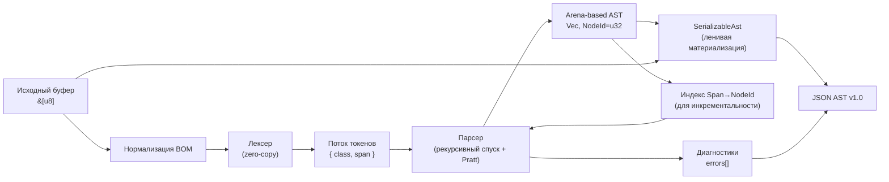

# Документ описания алгоритма парсера `c-parser`

**Версия документа:** 1.2  
**Статус:** Описание алгоритма для реализации  
**Связанные документы:** ТЗ на `c-parser` v2.2, Документ архитектуры `c-parser` v1.1, `docs/ast-schema.json` v1.0

---

## 1. Введение

Настоящий документ описывает алгоритм синтаксического анализа, реализуемый в модуле `c-parser`. Алгоритм предназначен для построения абстрактного синтаксического дерева (AST) по исходному коду на языке C с последующей сериализацией в JSON по схеме `ast-schema.json` v1.0. Документ детализирует этапы лексического и синтаксического анализа, стратегию обработки ошибок, механизм инкрементального обновления, а также структуры данных, обеспечивающие заявленные характеристики производительности и памяти.

Алгоритм является гибридным и сочетает:

- **arena-based представление AST** с 32-битными индексами;
- **zero-copy лексический анализ** с ленивой материализацией строк;
- **двухфазный синтаксический анализ**: рекурсивный спуск с контекстной таблицей символов и Pratt parsing для выражений;
- **инкрементальное обновление в памяти** с использованием отсортированного индекса `Span → NodeId`.

Документ соответствует требованиям ТЗ v2.2, архитектурному описанию v1.1 и схеме `ast-schema.json` v1.0.

---

## 2. Общая схема алгоритма

Алгоритм работает в несколько этапов:



1. **Нормализация BOM.** UTF-8 BOM (`EF BB BF`) отбрасывается или поглощается на раннем этапе, чтобы не сдвигать `Span` первого токена и сохранить контракт `span.start = 0` для файлов без BOM.
2. **Лексический анализ.** Исходный буфер просматривается один раз; формируются токены, содержащие только класс и `Span`. Строковые значения не копируются.
3. **Синтаксический анализ.** Выполняется в двух фазах:
   - **Фаза A** — рекурсивный спуск для объявлений и инструкций с контекстной таблицей символов для разрешения `typedef-name` vs `identifier`.
   - **Фаза B** — Pratt parsing для выражений, обеспечивающий линейное время O(n) и корректную обработку приоритетов и ассоциативности операторов.
4. **Построение AST.** Узлы добавляются в плоский массив `Vec<Node>` (арену); связи осуществляются через `NodeId = u32`. При синтаксических ошибках добавляются `ErrorNode` и записи в `errors[]`.
5. **Инкрементальный режим** (опционально). При изменении диапазона `Span` выполняется поиск минимального узла-контейнера по индексу `Span → NodeId`, инвалидация его поддерева и локальный переразбор. JSON автоматически не сериализуется.
6. **Сериализация.** `ast_to_json` принимает AST и исходный буфер, материализуя строковые поля по `Span` с помощью `String::from_utf8_lossy`.

---

## 3. Лексический анализ

### 3.1. Токены и zero-copy

Лексер обрабатывает исходный буфер `&[u8]` и выдаёт последовательность токенов. Каждый токен описывается структурой:

\[
t_i = \langle K, S, E \rangle
\]

где:

- \(K\) — класс токена (идентификатор, ключевое слово, литерал, оператор, разделитель, директива препроцессора и т.д.);
- \(S\) — начальное смещение лексемы в байтах;
- \(E\) — конечное смещение (полуинтервал \([S, E)\)).

Строковые значения (имена идентификаторов, литералы) **не копируются**. Это обеспечивает нулевое копирование на этапе анализа и снижает потребление памяти.

Лексер поддерживает:

- все лексемы C: идентификаторы, ключевые слова, литералы (целочисленные, вещественные, символьные, строковые, в т.ч. с префиксами кодировки C11 — `u8`, `u`, `U`, `L`), операторы, разделители, комментарии;
- комментарии: по умолчанию пропускаются, при флаге `include_comments` сохраняются в отдельном списке или как узлы AST;
- директивы препроцессора: в режиме `SingleTu` фиксируются как узлы AST без раскрытия; в режиме `Preprocessed` вход уже обработан, и директивы отсутствуют.

### 3.2. Обработка BOM

UTF-8 BOM (`EF BB BF`) в начале файла может сдвинуть `Span` первого токена на три байта, что нарушит контракт `span.start = 0` для файлов без BOM и усложнит материализацию строк. Поэтому лексер обязан отбросить BOM или корректно поглотить его на самом раннем этапе — до выдачи первого токена и до формирования каких-либо `Span`.

Требования:

- для файлов без BOM первый токен имеет `span.start = 0`;
- для файлов с BOM `Span`-ы не сдвигаются на три байта;
- `source_length` в итоговом AST отражает длину буфера после нормализации, чтобы инвариант `span.end ≤ source_length` оставался корректным;
- материализация строк по `Span` не захватывает BOM-байты.

### 3.3. Контекстная зависимость и таблица символов

Проблема «Lexer Hack»: лексер должен различать имена типов (`TYPEDEF_NAME`) и имена переменных (`IDENTIFIER`). Это невозможно без контекста. Решение:

- лексер не принимает окончательного решения о классе идентификатора;
- парсер (Фаза A) ведёт легковесную таблицу символов текущей области видимости;
- при встрече `typedef` следующий за ним идентификатор регистрируется в таблице;
- при чтении нового токена парсер выполняет \(O(1)\) запрос к таблице для классификации лексемы как `TYPEDEF_NAME` или `IDENTIFIER`.

Таблица символов ограничена пределами одной единицы трансляции (TU). В режиме `Preprocessed` корректное разрешение `typedef` гарантируется, так как вход уже обработан препроцессором. В режиме `SingleTu` разрешение работает только при наличии объявлений в анализируемом фрагменте.

---

## 4. Синтаксический анализ

### 4.1. Фаза A: рекурсивный спуск с контекстной таблицей символов

Фаза A предназначена для разбора объявлений (declarations) и инструкций (statements). Используется метод рекурсивного спуска: парсер движется по тексту программы сверху вниз, сопоставляя поток токенов с грамматическими правилами языка.

Ключевые особенности:

- **Контекстная таблица символов.** Поддерживается синхронно с разбором для разрешения неоднозначности `typedef-name` vs `identifier`. При встрече `typedef` идентификатор регистрируется в таблице; при разборе объявлений и выражений парсер запрашивает таблицу для классификации.
- **Диалекты C.** Поддерживаются C89, C99, C11, C17. Диалект влияет на набор ключевых слов, допустимые конструкции и правила грамматики.
- **Режимы препроцессинга.**
  - `Preprocessed` (по умолчанию): вход уже обработан, директивы отсутствуют, `typedef` разрешаются корректно.
  - `SingleTu`: директивы `#include`, `#define` и др. фиксируются как узлы AST без раскрытия; `typedef` разрешаются только в пределах доступного фрагмента.
- **Обработка ошибок.** При синтаксической ошибке выполняется упрощённое восстановление: пропуск токенов до ближайшей точки синхронизации (`;`, `{`, `}`), добавление `ErrorNode` в арену и продолжение разбора. Полноценный error recovery (а-ля `rustc`/`clang`) не является целью MVP.

Фаза A строит узлы следующих `NodeKind`:

- **Объявления и определения:** `FunctionDefinition` (payload — `DataFunctionDef`), `VariableDeclaration` (`DataVariableDecl`), `ParameterDeclaration` (`DataParameterDecl`), `TypedefDeclaration` (`DataTypedefDecl`), `StructDeclaration` (`DataStructDef`), `UnionDeclaration` (`DataUnionDef`), `EnumDeclaration` (`DataEnumDef`), `Enumerator` (`DataEnumerator`).
- **Инструкции:** `CompoundStatement`, `IfStatement`, `WhileStatement`, `DoWhileStatement`, `ForStatement`, `SwitchStatement`, `CaseStatement`, `DefaultStatement`, `ReturnStatement`, `BreakStatement`, `ContinueStatement`, `GotoStatement`, `LabelStatement`, `ExpressionStatement`, `NullStatement`.
- **Типовые конструкции:** `TypeSpecifier`, `PointerType`, `ArrayType`, `FunctionType`.
- **Инициализаторы:** `InitializerList`.
- **Директивы препроцессора** (в режиме `SingleTu`): `PreprocessorInclude`, `PreprocessorDefine`, `PreprocessorUndef`, `PreprocessorIf`, `PreprocessorIfdef`, `PreprocessorIfndef`, `PreprocessorElse`, `PreprocessorElif`, `PreprocessorEndif`, `PreprocessorPragma`, `PreprocessorLine`, `PreprocessorError`, `PreprocessorWarning`.

### 4.2. Фаза B: Pratt parsing для выражений

Выражения в C перенасыщены операторами с различными приоритетами и ассоциативностью. Классический рекурсивный спуск генерирует для них глубокий стек вызовов, что ухудшает временную сложность. Поэтому для выражений применяется **алгоритм Пратта** (top-down operator precedence).

Основные свойства:

- **Линейное время O(n).** Разбор выражения выполняется за один проход с плоским циклом и таблицей весов (binding power).
- **Корректная обработка приоритетов и ассоциативности.** Таблица binding power задаёт для каждого оператора левую и правую силу связывания.
- **Избегание глубокого стека.** Вместо рекурсивных вызовов на каждый оператор используется цикл, что снижает риск переполнения стека на сложных выражениях.

Фаза B строит узлы следующих `NodeKind` с соответствующими payload-типами:

| `NodeKind` | `data.type` (дискриминатор) | Обязательные поля payload | Опциональные поля |
|---|---|---|---|
| `Identifier` | `Identifier` | `name: string` | — |
| `IntegerLiteral` | `IntegerLiteral` | `value: string` | `suffix: string \| null` (отсутствует или `null` — без суффикса) |
| `FloatLiteral` | `FloatLiteral` | `value: string` | `suffix: string \| null` |
| `StringLiteral` | `StringLiteral` | `value: string` | `encoding: string \| null` |
| `CharLiteral` | `CharLiteral` | `value: string` | `encoding: string \| null` |
| `BinaryExpr` | `BinaryExpr` | `op: string` | — |
| `UnaryExpr` | `UnaryExpr` | `op: string`, `prefix: bool` | — |
| `AssignmentExpr` | `AssignmentExpr` | `op: string` | — |
| `CallExpr` | `CallExpr` | — (только `type`) | `is_macro: bool` (tri-state, см. ниже) |
| `MemberExpr` | `MemberExpr` | `op: "." \| "->"` | — |
| `IndexExpr` | `IndexExpr` | — (только `type`) | — |
| `CastExpr` | `CastExpr` | — (только `type`) | — |
| `TernaryExpr` | `TernaryExpr` | — (только `type`) | — |
| `SizeofExpr` | `SizeofExpr` | `is_variadic: bool` | — |
| `ParenExpr` | — (структурный, `data: null`) | — | — |

> **Полный перечень `NodeKind`.** Таблица выше охватывает узлы, которые строит Фаза B, но не является исчерпывающим списком всех `NodeKind`. Полный закрытый перечень зафиксирован в `$defs.NodeKind` схемы `ast-schema.json` v1.0 и включает также структурные узлы (`TranslationUnit`, `CompoundStatement`, `IfStatement`, `TypeSpecifier`, `PointerType`, `ArrayType`, `FunctionType`, `InitializerList` и др.), объявления (`FunctionDefinition`, `VariableDeclaration`, `ParameterDeclaration`, `TypedefDeclaration`, `StructDeclaration`, `UnionDeclaration`, `EnumDeclaration`, `Enumerator`) и директивы препроцессора (`Preprocessor*`). При добавлении новых конструкций разработчик обязан расширять именно `$defs.NodeKind`, при необходимости добавляя соответствующий `Data<Kind>` в `NodeData.oneOf` и per-kind enforcement в `Node.allOf` — атомарно, чтобы не рассинхронизировать схему с реализацией.

Pratt parsing обрабатывает:

- бинарные операторы (`+`, `-`, `*`, `/`, `%`, `<<`, `>>`, `<`, `>`, `==`, `!=`, `&`, `^`, `|`, `&&`, `||`, `?:`, присваивания и т.д.);
- унарные операторы (`+`, `-`, `!`, `~`, `*`, `&`, `++`, `--`, `sizeof`), для которых `prefix` отражает позицию;
- постфиксные операторы (`++`, `--`, `[]`, `()`, `.`, `->`);
- тернарный оператор `?:`;
- приведения типов и `sizeof(type)`; для VLA-форм `sizeof(int[n])` выставляется `is_variadic = true`.

**Tri-state семантика `CallExpr.is_macro`.** Поле опционально, отсутствие допустимо:

- `true` — парсер определил, что вызываемый идентификатор является макросом (например, известен из того же TU в режиме `SingleTu`);
- `false` — парсер определил, что это обычный вызов функции (или макрос раскрыт в вызов в режиме `Preprocessed`);
- поле отсутствует — неизвестно / не различается (поведение MVP); `code-bridge` обязан трактовать отсутствие как `false` и не полагаться на детекцию макросов.

### 4.3. Взаимодействие фаз

Фазы A и B координируются:

- Фаза A определяет контекст: объявление функции, переменной, инструкция;
- при необходимости разобрать выражение (например, в инициализаторе, условии `if`, теле `return`) управление передаётся Фазе B;
- Фаза B возвращает построенное поддерево выражения, которое встраивается в текущий узел Фазы A;
- таблица символов, поддерживаемая Фазой A, доступна и при разборе выражений (например, для `sizeof(type)`).

Такое разделение соответствует гибридному алгоритму, описанному в научной статье, и требованиям ТЗ.

---

## 5. Модель AST и соответствие схеме

### 5.1. Представление узла

Узел дерева (`Node`) содержит:

```rust
pub struct Node {
    pub kind: NodeKind,
    pub span: Span,
    pub children: Vec<NodeId>,
    pub data: Option<NodeData>,  // None ⇔ "data": null для структурных узлов
}
```

Схема `ast-schema.json` v1.0 задаёт ровно один перечень `NodeKind` (см. `enum` в `$defs.NodeKind`), который включает как структурные узлы без payload, так и узлы с типизированными атрибутами. Для узлов с атрибутами `data` — это tagged union с обязательным полем `type`, значением которого служит **сокращённый дискриминатор**. Для структурных узлов без атрибутов `data` **обязано** быть `null`.

### 5.2. Сокращённые дискриминаторы `data.type`

Правило: `kind` и `data.type` обычно совпадают, но для ряда объявлений используется сокращённый дискриминатор (зафиксировано в схеме):

| `NodeKind` | `data.type` |
|---|---|
| `FunctionDefinition` | `FunctionDef` |
| `VariableDeclaration` | `VariableDecl` |
| `ParameterDeclaration` | `ParameterDecl` |
| `TypedefDeclaration` | `TypedefDecl` |
| `StructDeclaration` | `StructDef` |
| `UnionDeclaration` | `UnionDef` |
| `EnumDeclaration` | `EnumDef` |

Для всех остальных узлов с payload `data.type` совпадает с `kind` (например, `Identifier`, `BinaryExpr`, `ErrorNode`, `PreprocessorDirective` для всех `Preprocessor*`).

### 5.3. Структурные узлы с `data: null`

Схема явно перечисляет `NodeKind`, для которых `data` **обязано** быть `null`:

`TranslationUnit`, `CompoundStatement`, `IfStatement`, `WhileStatement`, `DoWhileStatement`, `ForStatement`, `SwitchStatement`, `CaseStatement`, `DefaultStatement`, `ReturnStatement`, `BreakStatement`, `ContinueStatement`, `GotoStatement`, `LabelStatement`, `ExpressionStatement`, `NullStatement`, `ParenExpr`, `TypeSpecifier`, `PointerType`, `ArrayType`, `FunctionType`, `InitializerList`.

Это проверяется per-kind `oneOf` в определении `Node`; при расширении такого kind атрибутами необходимо атомарно добавить `Data<Kind>` в `NodeData.oneOf` и в соответствующую ветку per-kind enforcement.

### 5.4. Специфика отдельных payload-типов

Ниже — тонкости, которые парсер обязан соблюдать при сериализации и которые потребитель обязан учитывать при десериализации.

**`DataIdentifier.name`.** Строка, материализованная из исходного буфера по `Span` (lossy UTF-8).

**`DataIntegerLiteral` / `DataFloatLiteral`.** `value` — текст литерала как в исходнике (включая префиксы и hex-цифры). Поле `suffix` опционально: отсутствие и `null` эквивалентны «без суффикса»; потребитель обязан применять документированные значения по умолчанию. Внутри Rust это `Option<String>` с `#[serde(skip_serializing_if = "Option::is_none")]`.

**`DataStringLiteral` / `DataCharLiteral`.** `value` — сырой текст с кавычками как в исходнике. Поле `encoding` опционально (C11-префиксы `u8`, `u`, `U`, `L`); отсутствие или `null` означает «без префикса, либо парсер не различает префиксы на уровне AST». Для `CharLiteral` парсер вправе сохранять префикс в `value` дословно (например, `L'a'`); потребитель не должен полагаться ни на один из вариантов и при семантической важности обращается к `encoding`.

**`DataCallExpr.is_macro`.** Tri-state (см. п. 4.2). Отсутствие поля — нормальное поведение MVP.

**`DataStructDef.name` / `DataUnionDef.name` / `DataEnumDef.name`.** Могут быть `string` или `null` (анонимный тип).

**`DataEnumerator.value`.** `string` или `null`/отсутствует — для неявного значения.

**`DataSizeofExpr.is_variadic`.** Обязательное `bool`: `true` для `sizeof(int[n])`, `false` для обычного `sizeof`.

**`DataUnaryExpr.prefix`.** Обязательное `bool`: позиция унарного оператора.

**`DataMemberExpr.op`.** Ограничен значениями `"."` и `"->"`.

**`DataPreprocessorDirective`.** Для всех `Preprocessor*` kind используется единый `DataPreprocessorDirective` с обязательными `type: "PreprocessorDirective"`, `directive: string` и `argument: string`. Поле `argument` **всегда присутствует и всегда является строкой** (не `null`, не опускается): для директив без аргументов (`#else`, `#endif`) сериализуется как `"argument": ""`. На стороне Rust это `String`, не `Option<String>`. Кросс-проверка «`directive` соответствует суффиксу `kind`» (например, `PreprocessorInclude` → `"include"`) выполняется кастомным валидатором, а не JSON Schema.

**`DataErrorNode.error_index`.** Обязательный `integer ≥ 0`, индекс в массиве `errors[]`. Ссылочная целостность проверяется кастомным валидатором.

### 5.5. Span и инварианты

`Span` — полуинтервал `[start, end)` в байтах исходного буфера. Помимо ограничений JSON Schema, кастомный валидатор (`tests/schema_validation.rs`) и сам парсер обеспечивают:

- `span.start <= span.end`;
- `span.end <= source_length`;
- `root` и каждый `children[]` ссылаются на существующий индекс `nodes[]`;
- `ErrorNode.data.error_index` ссылается на существующую запись `errors[]`;
- для `Preprocessor*` kind поле `data.directive` соответствует суффиксу `kind`;
- структурные kind имеют `data: null`;
- `DataPreprocessorDirective.argument` — всегда строка, для директив без аргументов `""`.

Опциональные поля `suffix`, `encoding`, `is_macro` могут отсутствовать; потребитель обязан применять документированные значения по умолчанию.

### 5.6. Ленивая материализация строк

Внутри арены узлы хранят только `Span`. Строковые поля (`name`, `value`, `op`, `storage_class` и т.п.) в структуре `Node` отсутствуют. При сериализации `ast_to_json` принимает исходный буфер `&[u8]` и извлекает подстроки по `Span` **только** для полей, требующих материализации:

```rust
String::from_utf8_lossy(&source[span.start..span.end]).into_owned()
```

Некорректные байты заменяются на ``; парсер не падает на невалидном UTF-8. Это гарантирует самодостаточность JSON и не нарушает zero-copy на этапах анализа.

---

## 6. Обработка ошибок

### 6.1. Нефатальные ошибки

Все ошибки (лексические, синтаксические) возвращаются структурированно в массиве `errors[]`. Каждая запись соответствует схеме `$defs.Error`:

```json
{
  "code": "E_SYNTAX_EXPECTED_SEMICOLON",
  "message": "expected `;` after expression",
  "span": { "start": 42, "end": 42 },
  "severity": "error"
}
```

Обязательные поля: `code` (стабильный машиночитаемый код), `message`, `span`, `severity` (enum: `"error"`, `"warning"`, `"note"`, `"info"`). Дополнительные поля запрещены (`additionalProperties: false`).

Нефатальные ошибки не прерывают разбор. Парсер продолжает работу, добавляя `ErrorNode` в AST.

### 6.2. Узел `ErrorNode`

При синтаксической ошибке в арену добавляется **полноценный узел** `ErrorNode` с payload `DataErrorNode`:

```json
{
  "kind": "ErrorNode",
  "span": { "start": 42, "end": 50 },
  "children": [],
  "data": { "type": "ErrorNode", "error_index": 0 }
}
```

Требования:

- корректный `Span`, охватывающий проблемный фрагмент и, по возможности, распознанные токены до точки синхронизации;
- корректный массив `children` — индексы узлов, которые парсер смог построить до ошибки (может быть пустым);
- `data.error_index` ссылается на соответствующую запись в массиве `errors[]`.

Это гарантирует, что AST остаётся связным валидным графом, сериализация не падает, а `code-bridge` может подсветить ошибку в нужном месте исходного файла.

### 6.3. Стратегия восстановления

При синтаксической ошибке парсер выполняет упрощённое восстановление:

1. Пропускает токены до ближайшей точки синхронизации: `;`, `{`, `}`.
2. Добавляет `ErrorNode` в арену с корректным `Span`, `children` и `data.error_index`.
3. Добавляет запись в `errors[]`.
4. Продолжает разбор со следующей конструкции.

Полноценный error recovery уровня промышленного компилятора (`rustc`, `clang`) не является целью MVP и вынесен в перспективные задачи.

### 6.4. Фатальные ошибки

При фатальных ошибках (например, переполнение буфера, приближение к пределу `NodeId = u32`) возвращается `Err`. Парсер не зацикливается и не паникует. Фатальные ошибки не попадают в `errors[]` — они возвращаются через API/CLI.

---

## 7. Инкрементальный режим

### 7.1. Назначение

Инкрементальный режим предназначен для минимизации временных затрат при модификации исходного кода. Он работает **исключительно в памяти** и не предполагает постоянной сериализации в JSON после каждого обновления (иначе выгода от O(log N + K) нивелируется O(N)-сериализацией). JSON генерируется по требованию — например, при сохранении файла или запросе на транспиляцию.

### 7.2. Алгоритм обновления

При поступлении сигнала о модификации кода в диапазоне \(M = [M_{start}, M_{end})\):

1. **Поиск узла-контейнера.** По отсортированному индексу `Span → NodeId` (модуль `index/`) выполняется поиск минимального узла, чей `Span` полностью покрывает \(M\). Это может быть тело функции, блочный оператор `{}` или иная конструкция.
2. **Инвалидация.** Инвалидируются (удаляются) дочерние индексы найденного узла.
3. **Локальный переразбор.** Лексический и синтаксический анализ перезапускаются локально — только для текста в границах повреждённого узла.
4. **Добавление новых поддеревьев.** Новые узлы добавляются в арену, индексы обновляются.

### 7.3. Индекс `Span → NodeId`

Узлы добавляются в арену в порядке обхода и не гарантированно отсортированы по `span.start`. Поэтому «сырой» бинарный поиск по `Vec<Node>` некорректен. Для честного выполнения требования \(O(\log N)\) парсер поддерживает **отдельный отсортированный индекс** `Vec<(Span, NodeId)>` (модуль `src/index/`), который пересортировывается/обновляется при мутациях арены.

Для MVP рекомендуется именно отсортированный вектор индексов: он проще в реализации и достаточен для заявленной сложности. При этом выбор конкретной структуры данных для индекса **не является частью внешнего контракта алгоритма**: при переходе к полноценной поддержке LSP (большие проекты, частые точечные правки, необходимость в диапазонных запросах) отсортированный вектор может быть заменён на интервальное дерево (interval tree) — собственную упрощённую реализацию или сторонний крейт, например `interval-tree`, — без изменения публичного API `parse_incremental`, формата JSON AST и семантики инвалидации. Это согласуется с перспективами, зафиксированными в п. 11.2.

### 7.4. Сложность

Временная сложность частичного обновления:

\[
O(\log N + K)
\]

где \(N\) — общее число узлов, \(K\) — размер модифицированного блока. Это соответствует требованию ТЗ и научной статьи для интеграции в LSP-серверы и среды разработки.

---

## 8. Структуры данных

### 8.1. Arena-based AST

AST представляется как плоский массив узлов:

\[
T = \langle A, R \rangle
\]

где:

- \(A\) — одномерный массив узлов (`Vec<Node>`);
- \(R \in \mathbb{N}\) — индекс корневого узла (`NodeId`).

Ключевые свойства:

- **O(1) добавление узла** — добавление в конец `Vec<Node>`;
- **пространственная локальность** — смежные узлы лежат рядом, что уменьшает промахи кэша при обходе;
- **отсутствие указателей** — связи через `NodeId = u32`;
- **стабильные индексы** — узлы не перемещаются при добавлении новых.

### 8.2. Ограничение `NodeId = u32`

Использование 32-битных индексов ограничивает максимальное количество узлов в дереве примерно 4.29 млрд (\(2^{32} - 1\)), что с огромным запасом покрывает любые разумные размеры входных файлов: даже файл в 100 МБ на C создаст меньше 10–20 млн узлов, то есть на два порядка меньше предела. При приближении к пределу арена возвращает фатальную ошибку (`Err`) до переполнения индекса, а не зацикливается и не паникует.

Это осознанный компромисс: 32 бита вдвое сокращают размер узла по сравнению с 64-битными индексами и улучшают пространственную локальность, а запас по ёмкости для реальных кодовых баз остаётся практически неисчерпаемым.

### 8.3. Span

`Span` — полуинтервал `[start, end)` в байтах исходного буфера. Инварианты перечислены в п. 5.5.

---

## 9. Сложность и производительность

### 9.1. Временная сложность

- **Лексический анализ:** \(O(n)\), где \(n\) — длина исходного буфера.
- **Синтаксический анализ:** \(O(n)\) для типичных конструкций; Pratt parsing обеспечивает линейное время для выражений.
- **Построение AST:** \(O(m)\), где \(m\) — количество узлов.
- **Инкрементальное обновление:** \(O(\log N + K)\), где \(N\) — общее число узлов, \(K\) — размер модифицированного блока.
- **Сериализация:** \(O(m + L)\), где \(m\) — количество узлов, \(L\) — суммарная длина материализуемых строк.

### 9.2. Пространственная сложность

- **Исходный буфер:** \(O(n)\).
- **Арена узлов:** \(O(m)\); каждый узел содержит `kind`, `span`, `children`, `data`.
- **Индекс `Span → NodeId`:** \(O(m)\) для отсортированного вектора.
- **Потребление памяти на этапе анализа:** не более 10-кратного размера исходного файла (без учёта JSON-сериализации).

### 9.3. Целевые показатели

- Парсинг и сериализация в JSON файла размером 1 МБ (например, `sqlite3.c`) — не более 100 мс на современном CPU.
- Потокобезопасность: независимые экземпляры парсера могут работать параллельно (`Send + Sync`).

---

## 10. Взаимодействие с сериализацией

### 10.1. `SerializableAst`

Трейт `serde::Serialize` не принимает внешних аргументов, поэтому при сериализации `Ast` (где узлы хранят только `Span`) используется паттерн «обёртки»:

```rust
pub struct SerializableAst<'a> {
    pub ast: &'a Ast,
    pub source: &'a [u8],
}

impl<'a> Serialize for SerializableAst<'a> {
    fn serialize<S>(&self, serializer: S) -> Result<S::Ok, S::Error>
    where
        S: Serializer,
    {
        // Ручной обход self.ast.nodes и построение JSON-объекта:
        //   - подставляем kind, span, children;
        //   - для NodeData со строковыми полями извлекаем подстроку
        //     String::from_utf8_lossy(&self.source[span.start..span.end]);
        //   - маппим NodeData enum в JSON-объект с обязательным `type`
        //     (сокращённые дискриминаторы для FunctionDef/VariableDecl/...);
        //   - структурные kind сериализуем с `"data": null`;
        //   - собираем объект через serializer.serialize_map(...).
    }
}

pub fn ast_to_json(ast: &Ast, source: &[u8]) -> Result<String, serde_json::Error> {
    serde_json::to_string(&SerializableAst { ast, source })
}
```

`serde` не передаёт контекст вглубь рекурсии автоматически, поэтому реализация `Serialize` для `SerializableAst` содержит ручной обход `self.ast.nodes` с подстановкой строк по `Span` и ручным маппингом `NodeData` enum в JSON-объект (например, через `serializer.serialize_map`). Это осознанная цена за честный Zero-copy + Lazy materialization; код будет несколько многословным, но предсказуемым.

### 10.2. Правила сериализации, вытекающие из схемы

- **`version`:** константа `"1.0"`.
- **`language`:** константа `"c"`.
- **`source_length`:** длина исходного буфера после нормализации BOM.
- **`root` и `children[]`:** индексы в `nodes[]`; ссылочная целостность проверяется кастомным валидатором.
- **`errors[]`:** массив нефатальных диагностик; фатальные ошибки сюда не попадают.
- **Структурные `kind`:** `"data": null` (per-kind enforcement в схеме).
- **`Preprocessor*` kind:** единый `DataPreprocessorDirective`; `argument` всегда строка, для директив без аргументов — `""`.
- **Опциональные поля:** `suffix`, `encoding`, `is_macro`, `DataEnumerator.value`, `name` анонимных `struct`/`union`/`enum` — либо отсутствуют, либо `null`; потребитель обязан применять документированные значения по умолчанию.

### 10.3. Десериализация

`ast_from_json` читает строки напрямую из JSON; восстановление `Span`-ассоциации с исходным буфером не требуется (генератор получает готовые строки). Потребитель обязан:

- отвергать документы с несовпадающей мажорной версией `version`;
- проверять инварианты, не выразимые в JSON Schema (см. п. 5.5), либо полагаться на то, что их проверил источник;
- толерантно относиться к отсутствию опциональных полей (`suffix`, `encoding`, `is_macro`).

---

## 11. Ограничения и перспективы

### 11.1. Ограничения MVP

- Полноценный препроцессор C не реализуется. Поддерживаются режимы `Preprocessed` и `SingleTu`.
- Межфайловый анализ не входит в зону ответственности; делегируется `code-bridge`.
- Промышленный error recovery (а-ля `rustc`/`clang`) не является целью MVP; реализуется упрощённая стратегия с `ErrorNode`.
- Инкрементальность работает in-memory и не сериализует JSON автоматически.
- Детекция макросов (`CallExpr.is_macro`) в MVP отсутствует; поле может не сериализоваться.
- Индекс `Span → NodeId` реализуется как отсортированный вектор — достаточно для заявленной сложности \(O(\log N)\) и текущих сценариев использования.

### 11.2. Перспективы

- Расширение на другие языки (`cpp-parser`, `rust-parser`, `python-parser`) без пересмотра архитектуры: единый `ParserPlugin`, единый JSON-формат с полем `language`, версионируемая схема.
- Развитие error recovery до уровня промышленного компилятора.
- **Замена отсортированного вектора индексов на интервальное дерево** при переходе к полноценной поддержке LSP (большие проекты, частые точечные правки, диапазонные запросы). Это внутренняя оптимизация, не затрагивающая публичный API `parse_incremental`, формат JSON AST и семантику инвалидации (см. п. 7.3).
- Добавление детекции макросов и заполнение `CallExpr.is_macro`.
- Поддержка других кодировок исходных файлов (Windows-1251, KOI8-R) на уровне входного буфера.

---

## 12. Заключение

Описанный алгоритм сочетает arena-based AST, zero-copy лексический анализ с ленивой материализацией строк и гибридный парсер «рекурсивный спуск + Pratt». Эти решения обеспечивают:

- высокую производительность и экономию памяти;
- стабильный, самодостаточный JSON-формат AST, соответствующий `ast-schema.json` v1.0;
- инкрементальное обновление в памяти с сложностью \(O(\log N + K)\);
- безопасность памяти и потокобезопасность;
- возможность тиражирования для других языков без изменения архитектурного контракта.

Алгоритм соответствует требованиям ТЗ v2.2, архитектурному описанию v1.1 и научной статье, описывающей оптимизированный парсер для языка C.
